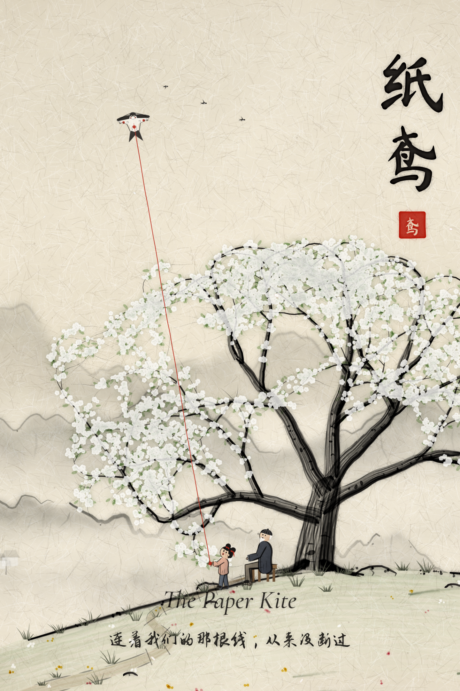

# 纸鸢 · The Paper Kite

一部 4 分 41 秒的 2D 水墨卡通动画短片，无对白。

> 会扎风筝的爷爷，每年春天都和孙女小燕在山坡老梨树下放一只沙燕风筝。小燕长大离家，爷爷一年年独自放飞，望着山路等她。爷爷走后，红线断了。多年后，她带着女儿回到树下，用一个结把断掉的红线重新接上。



## 观看

- 成片：[`output/the-paper-kite_1080p.mp4`](output/the-paper-kite_1080p.mp4)（1920×1080，24 fps，H.264 + AAC，-16 LUFS）
- 海报：[`output/poster.png`](output/poster.png)
- 剧照：[`output/stills/`](output/stills/)

## 文档

- [剧本与分镜](docs/剧本与分镜.md)：梗概、人物、镜头表、色彩脚本、声音设计
- [投递材料与导演阐述（草稿）](docs/导演阐述.md)：中英文简介，可修改后用于影展投递
- [素材来源与许可](docs/CREDITS.md)

## 它是怎么做出来的

每一帧画面都由代码绘制，没有手绘逐帧，也没有现成的动画素材。

- **画面**（`film/`）：在 Chromium 里用 Canvas2D 画墨层（笔触库模拟侧锋、飞白、墨点、晕染），再用 WebGL 着色器做水墨后期：墨色洇开、湿边、颜料浓淡、宣纸纹理、暗角。每个镜头分四层：背景、背景白粉、前景（人物与道具）、前景白粉。背景的手绘晃动固定不动，前景墨线每两帧“呼吸”一次；特写和中景给背景做景深虚化；镜头前可以挂一枝虚化的梨花。
- **人物**：参数化骨骼，随年龄改变头身比；关键姿势插值的走、跑循环（脚跟到脚尖、起伏、摆臂），起跳有预备下蹲和落地缓冲；呼吸、重心轻移、眨眼；头绳、马尾、衣摆、胡须按速度滞后摆动；表情由眉毛和嘴形连续变化；夕阳下有轮廓光。近景自动换成单独建模的手（指节、指甲、老人的青筋和老人斑）。
- **世界**：远山、云雾、山谷里的村落和山脊上的小塔、山坡与一棵程序生成的老梨树。四季共用同一副枝干，只换花、叶、雪；春天有野花和透过树冠的光束，夏夜有萤火虫，秋天有雁阵，冬天雪地上留下脚印。
- **字**：片名“纸鸢”和题诗按真实笔顺一笔一笔写出（笔画数据来自 Make Me a Hanzi）。
- **配乐**（`audio/score.py`、`audio/engine.py`）：代码作曲，一个五声音阶主题贯穿七段配乐，按剪辑点卡点。自写的 SFZ 采样器演奏 VSCO 2 CE 的弦乐、长笛、竖琴、钟琴、定音鼓和 Salamander 大钢琴；二胡、笛、箫靠滑音、揉弦、气声扮演；古筝是物理建模（`audio/guzheng.py`）。
- **声音**（`audio/sfx.py`、`audio/mix.py`）：环境声用 OpenGameArt 的 CC0 实录，脚步按画面步态逐步对齐，其余动作音效由程序合成；音乐起来时环境声自动让位，总线轻压缩、真峰值限幅，-16 LUFS。

## 重新渲染

需要 Node.js（含 Playwright 与 Chromium）、Python 3、FFmpeg。

```bash
python3 -I tools/fetch_assets.py              # 下载字体、音色库、音效，稀疏检出采样库（记录在 assets/manifest.json）
pip install numpy scipy soundfile Pillow
pip install --no-deps tinysoundfont

# 可选：重新抽取笔画数据（已随仓库提交 film/src/type/strokes.js）
# curl -o assets/hanzi/graphics.txt https://raw.githubusercontent.com/skishore/makemeahanzi/master/graphics.txt
# python3 -I tools/extract_strokes.py assets/hanzi/graphics.txt

node render/stills.mjs --cues build/cues.json # 导出剪辑点
python3 -I audio/score.py                     # 作曲并渲染配乐
python3 -I audio/sfx.py                       # 环境声与音效
python3 -I audio/mix.py                       # 混音 → build/audio/final.wav

node render/render.mjs                        # 1080p 全片画面 → build/video.mp4（4 进程并行）
tools/finalize.sh                             # 两遍编码封装 → output/the-paper-kite_1080p.mp4（< 100MB）
```

常用开发命令：

```bash
node render/render.mjs --preview                       # 960×540、12fps 样片
node render/stills.mjs --shot S05 --lt 1.4,5           # 某个镜头的静帧
node render/stills.mjs --every 2 --w 480 --contact build/contact.png   # 联系表
node render/stills.mjs --shot CAST --lt 0.5,1.5,3.5      # 角色表（开发用镜头 CAST、HANDS）
```

## 目录

```
film/            渲染页与全部画面代码
  src/core/      时间轴、缓动、噪声、相机、画布
  src/ink/       宣纸、笔触、WebGL 水墨后期
  src/world/     远山、云、山坡、老梨树、粒子、远景点景、前景花枝与光束
  src/actors/    人物骨骼与角色表、近景的手与道具、风筝、红线、线拐子、燕子
  src/type/      笔顺数据（Arphic 公共许可）与毛笔书写
  src/shots/     各镜头（act1/act2/act3/end）
  src/timeline.js 剪辑表
render/          逐帧渲染、静帧与联系表
audio/           作曲、SFZ 采样器、物理建模古筝、音效、混音
tools/           素材下载、联系表、音频对照图
docs/            剧本、投递材料、素材许可
output/          成片、海报、剧照
```
